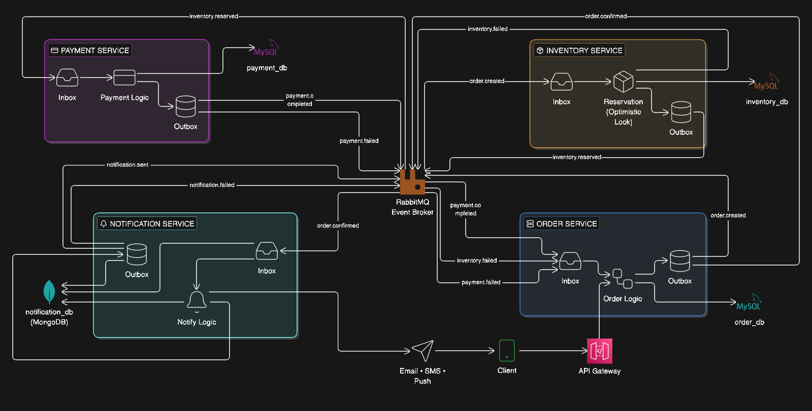
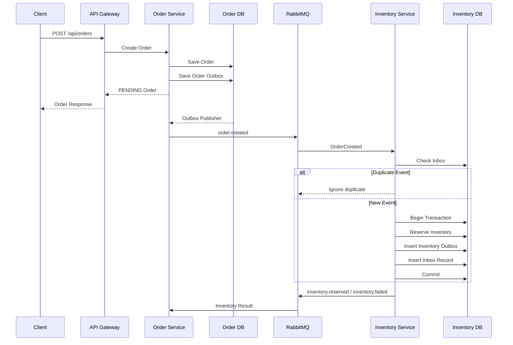
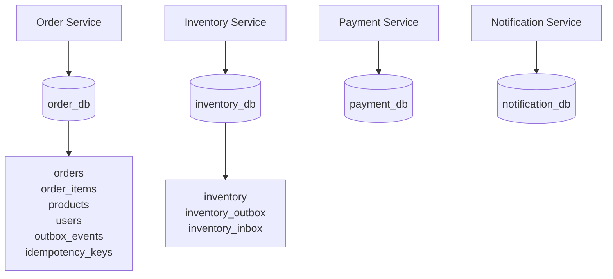

# Distributed Order Processing System

A production-oriented **distributed order processing system** built with **Spring Boot, Java, MySQL, RabbitMQ, Docker, Flyway, and an API Gateway**.

The project demonstrates how to build a reliable event-driven backend using **asynchronous messaging, transactional outbox, inbox/idempotency, optimistic locking, retries, and database-per-service architecture**.

[//]: # (> **Project status:** The Order → Inventory portion is implemented and tested end-to-end. Payment and Notification services are scaffolded for the next stages of the system.)

---

## Architecture Overview

The system follows an event-driven microservices architecture.



---

# Core Order → Inventory Flow

The current implemented business flow is:



---

# Services

## 1. API Gateway

The API Gateway is the external entry point for the system.

Responsibilities:

- Exposes the public API.
- Routes client requests to backend services.
- Keeps internal service endpoints isolated from clients.
- Provides a single entry point for the distributed system.

Current Docker service:

```text
api-gateway
```

---

## 2. Order Service

The Order Service owns order-related data and order lifecycle management.

Responsibilities:

- Create orders.
- Validate and persist order data.
- Handle idempotent order creation.
- Publish `OrderCreated` events.
- Maintain the Order Service outbox.
- Consume inventory reservation results.
- Update order state based on downstream events.

### Order lifecycle

```text
PENDING
   │
   ├── inventory.reserved
   │        ↓
   │    RESERVED
   │
   └── inventory.failed
            ↓
     INVENTORY_FAILED
```

---

## 3. Inventory Service

The Inventory Service owns inventory data and is isolated from the Order Service database.

Responsibilities:

- Maintain available inventory.
- Reserve inventory.
- Reject reservations when stock is insufficient.
- Use optimistic locking for concurrent inventory updates.
- Persist inventory events using the transactional outbox pattern.
- Consume `OrderCreated` events.
- Prevent duplicate event processing using an Inbox table.
- Publish inventory results asynchronously.

### Inventory state

For each product:

```text
available_quantity
reserved_quantity
version
```

Inventory reservation:

```text
available_quantity -= requested_quantity
reserved_quantity  += requested_quantity
```

If insufficient inventory exists, the inventory transaction is rolled back.

---

# Event-Driven Communication

RabbitMQ is used as the asynchronous messaging backbone.

## Exchanges

### Order Events

```text
order.events
```

Current routing key:

```text
order.created
```

### Inventory Events

```text
inventory.events
```

Routing keys:

```text
inventory.reserved
inventory.failed
```

### Inventory Queue

```text
inventory.orders
```

The queue is bound to:

```text
order.events
        │
        └── order.created
                ↓
        inventory.orders
```

---

# Transactional Outbox Pattern

The system avoids the unreliable pattern of:

```text
UPDATE database
      ↓
publish RabbitMQ message
```

because a database commit and RabbitMQ publish are two separate operations.

Instead, the service performs:

```text
Database Transaction
       │
       ├── Business Data Update
       │
       └── Outbox Event Insert
                │
                ▼
              COMMIT
                │
                ▼
        Outbox Publisher
                │
                ▼
             RabbitMQ
```

This guarantees that the business state change and the intent to publish the event are persisted atomically.

---

# Inventory Transaction

For a successful reservation:

```text
BEGIN TRANSACTION

Inventory UPDATE
      +
Inventory Outbox INSERT
      +
Inbox INSERT

COMMIT
```

For insufficient stock:

```text
BEGIN TRANSACTION

Inventory reservation
      ↓
Insufficient stock
      ↓
ROLLBACK

BEGIN NEW TRANSACTION

Inventory Failed Outbox INSERT
      +
Inbox INSERT

COMMIT
```

This ensures that an unsuccessful reservation does **not** reduce available inventory.

---

# Outbox Publisher

The Inventory Service contains an asynchronous outbox publisher.

Its responsibilities include:

- Find pending outbox events.
- Publish events to RabbitMQ.
- Mark successfully published events as `PUBLISHED`.
- Track publishing attempts.
- Schedule retry attempts after failures.
- Store the last publishing error.
- Stop retrying after the configured maximum number of attempts.

Current default configuration:

```text
Batch size:       20
Maximum attempts: 5
Publisher delay:  3 seconds
```

The design provides **at-least-once delivery**.

Therefore:

```text
RabbitMQ publish succeeds
        ↓
DB status update fails
        ↓
Event may be published again
```

Duplicate delivery is handled by consumers using event identity and Inbox/idempotency.

---

# Inbox / Idempotency Pattern

The Inventory Service maintains:

```text
inventory_inbox
```

Each consumed event is recorded using a unique event ID.

Conceptually:

```text
RabbitMQ Event
      │
      ▼
Check Inbox
      │
      ├── Already exists → Ignore
      │
      └── New event
             │
             ▼
       Process event
             │
             ├── Update inventory
             ├── Create outbox event
             └── Insert inbox record
```

The Inbox and business operation are handled within the same database transaction.

This protects the service against repeated delivery of the same message.

---

# Optimistic Locking

Inventory uses JPA optimistic locking:

```java
@Version
private Long version;
```

This helps prevent lost updates when multiple requests attempt to modify the same inventory record concurrently.

Conceptually:

```text
Transaction A                  Transaction B

Read version 3                 Read version 3
       │                              │
Update inventory                Update inventory
       │                              │
Commit version 4                Version conflict
                                      │
                                   Retry/fail
```

---

# Retry and Backoff

Outbox publishing failures are persisted rather than silently discarded.

The outbox tracks:

```text
attempts
next_attempt_at
last_error
status
published_at
```

Status values:

```text
PENDING
PUBLISHED
FAILED
```

The publisher uses increasing retry delays and eventually marks an event as `FAILED` after the maximum number of attempts.

---

# Correlation and Causation

Events carry workflow metadata such as:

```text
eventId
correlationId
causationId
```

The intended relationship is:

```text
Correlation ID
    │
    └── identifies the overall business workflow

Causation ID
    │
    └── identifies the event that caused the current event

Event ID
    │
    └── identifies the individual event
```

The current implementation preserves correlation and causation information while the event-identity model is being evolved incrementally.

---

# Database-per-Service Architecture

The system is moving toward strict database ownership.



### Current databases

```text
order_db
inventory_db
payment_db
notification_db
```

The Inventory Service has already been separated from the legacy shared `orders` database.

This means Inventory owns:

```text
inventory_db
├── inventory
├── inventory_outbox
├── inventory_inbox
└── flyway_schema_history
```

---

# Database Migrations

Database schemas are managed using **Flyway**.

Example Inventory migration structure:

```text
inventory-service/
└── src/
    └── main/
        └── resources/
            └── db/
                └── migration/
                    ├── V1__create_inventory.sql
                    ├── V2__create_inventory_outbox.sql
                    └── V3__seed_inventory.sql
```

Hibernate is configured with:

```yaml
spring:
  jpa:
    hibernate:
      ddl-auto: validate
```

This keeps schema ownership with Flyway rather than allowing Hibernate to modify production schemas automatically.

---

# Idempotent Order Creation

The Order API accepts:

```http
Idempotency-Key: <unique-key>
```

This prevents accidental creation of multiple orders when the same client request is submitted repeatedly.

Conceptually:

```text
Request
   │
   ▼
Idempotency Key
   │
   ├── Already processed → Return existing result
   │
   └── New key
          │
          ▼
      Create Order
```

---

# Dockerized Development Environment

The complete development environment is containerized using Docker Compose.

Current infrastructure includes:

```text
MySQL 8.4
RabbitMQ 4
Order Service
Inventory Service
Payment Service
Notification Service
API Gateway
```

Start the system:

```bash
docker compose up -d --build
```

Check running containers:

```bash
docker compose ps
```

View service logs:

```bash
docker compose logs -f inventory-service
```

---

# RabbitMQ Management

RabbitMQ Management UI is exposed locally at:

```text
http://localhost:15672
```

The configured Docker ports are:

```text
5672   AMQP
15672  Management UI
```

The management interface can be used to inspect:

- Exchanges
- Queues
- Consumers
- Message rates
- Connections
- Bindings

---

# MySQL

MySQL is exposed locally on:

```text
3306
```

The development environment uses Docker Compose environment variables for credentials.

Example:

```env
MYSQL_DATABASE=orders
MYSQL_USER=app
MYSQL_PASSWORD=app_password
MYSQL_ROOT_PASSWORD=root_password

RABBITMQ_USER=app
RABBITMQ_PASSWORD=rabbit_password
```

> Do not commit real production credentials or secrets to GitHub. Use environment variables or a secret-management system in production.

---

# Technology Stack

| Technology | Purpose |
|---|---|
| Java 21 | Application runtime |
| Spring Boot 3.5.x | Microservice framework |
| Spring Data JPA | Persistence |
| Hibernate | ORM |
| MySQL 8.4 | Relational database |
| Flyway | Database migrations |
| RabbitMQ 4 | Event/message broker |
| Spring AMQP | RabbitMQ integration |
| Docker | Containerization |
| Docker Compose | Local orchestration |
| Maven | Build/dependency management |
| API Gateway | External API routing |

---

# Reliability Patterns Demonstrated

This project is designed around several distributed-systems patterns.

## Transactional Outbox

Prevents the database update and event publication intent from becoming inconsistent.

## Inbox / Idempotent Consumer

Prevents duplicate message delivery from causing duplicate business operations.

## At-Least-Once Delivery

Events are persisted until successfully published, allowing failed publishing attempts to be retried.

## Retry with Backoff

Temporary messaging failures are retried instead of immediately losing events.

## Optimistic Locking

Protects concurrent inventory modifications.

## Correlation ID

Allows a business workflow to be traced across services.

## Causation ID

Records which event caused another event.

## Database-per-Service

Each service owns its persistent state and communicates through events rather than direct database access.

## Saga-Oriented Workflow

Business operations are distributed across services and coordinated through asynchronous events.

---

# Failure Scenarios

The architecture explicitly considers common distributed-system failure cases.

### Database succeeds, RabbitMQ publish fails

```text
Business transaction
       ↓
COMMIT
       ↓
Outbox remains PENDING
       ↓
Publisher retries
```

### RabbitMQ publish succeeds, DB status update fails

```text
RabbitMQ receives event
       ↓
DB update fails
       ↓
Event can be published again
       ↓
Consumer Inbox detects duplicate
```

### Consumer receives the same event twice

```text
Event #10
   ↓
Inbox does not contain 10
   ↓
Process
   ↓
Inbox stores 10

Event #10 again
   ↓
Inbox contains 10
   ↓
Ignore
```

### Insufficient inventory

```text
OrderCreated
     ↓
Inventory Service
     ↓
Insufficient stock
     ↓
Inventory transaction rolls back
     ↓
inventory.failed
     ↓
RabbitMQ
```

---

# Testing the Inventory Flow

## Successful reservation

Create an order with an available product:

```bash
curl -X POST http://localhost:8080/api/orders \
  -H "Content-Type: application/json" \
  -H "Idempotency-Key: inventory-test-success-001" \
  -d '{
    "userId": 2,
    "items": [
      {
        "productId": 4,
        "quantity": 5
      }
    ]
  }'
```

Expected behavior:

```text
available_quantity decreases
reserved_quantity increases
version increments
inventory_outbox receives INVENTORY_RESERVED
event is published to inventory.reserved
```

---

## Insufficient inventory

```bash
curl -X POST http://localhost:8080/api/orders \
  -H "Content-Type: application/json" \
  -H "Idempotency-Key: inventory-test-failure-001" \
  -d '{
    "userId": 2,
    "items": [
      {
        "productId": 5,
        "quantity": 100
      }
    ]
  }'
```

Expected behavior:

```text
Inventory remains unchanged
        +
INVENTORY_FAILED is inserted into the outbox
        +
event is published to inventory.failed
```

---

# Project Structure

```text
Directory structure:
└── distributed-order-processing-system/
    ├── README.md
    ├── docker-compose.yml
    ├── pom.xml
    ├── api-gateway/
    │   ├── Dockerfile
    │   ├── pom.xml
    │   └── src/
    │       └── main/
    │           ├── java/
    │           │   └── com/
    │           │       └── example/
    │           │           └── api.gateway/
    │           │               └── Application.java
    │           └── resources/
    │               └── application.yml
    ├── docs/
    │   └── architecture.md
    ├── inventory-service/
    │   ├── Dockerfile
    │   ├── pom.xml
    │   └── src/
    │       └── main/
    │           ├── java/
    │           │   └── com/
    │           │       └── example/
    │           │           └── inventory.service/
    │           │               ├── Application.java
    │           │               ├── config/
    │           │               │   └── RabbitMQConfig.java
    │           │               ├── entity/
    │           │               │   ├── Inventory.java
    │           │               │   ├── InventoryInboxEvent.java
    │           │               │   └── InventoryOutboxEvent.java
    │           │               ├── messaging/
    │           │               │   ├── InventoryEventListener.java
    │           │               │   ├── InventoryFailedEvent.java
    │           │               │   ├── InventoryOutboxPublisher.java
    │           │               │   ├── InventoryReservationResult.java
    │           │               │   ├── InventoryReservationResultListener.java
    │           │               │   ├── InventoryReservedEvent.java
    │           │               │   └── OrderCreatedEvent.java
    │           │               ├── repository/
    │           │               │   ├── InventoryInboxRepository.java
    │           │               │   ├── InventoryOutboxRepository.java
    │           │               │   └── InventoryRepository.java
    │           │               └── service/
    │           │                   └── InventoryService.java
    │           └── resources/
    │               ├── application.yml
    │               └── db/
    │                   └── migration/
    │                       ├── V1__create_inventory.sql
    │                       ├── V2__create_inventory_outbox.sql
    │                       ├── V3__seed_inventory.sql
    │                       └── V4__create_inventory_inbox.sql
    ├── notification-service/
    │   ├── Dockerfile
    │   ├── pom.xml
    │   └── src/
    │       └── main/
    │           ├── java/
    │           │   └── com/
    │           │       └── example/
    │           │           └── notification.service/
    │           │               └── Application.java
    │           └── resources/
    │               └── application.yml
    ├── order-service/
    │   ├── Dockerfile
    │   ├── pom.xml
    │   └── src/
    │       └── main/
    │           ├── java/
    │           │   └── com/
    │           │       └── example/
    │           │           └── order/
    │           │               └── service/
    │           │                   ├── Application.java
    │           │                   ├── config/
    │           │                   │   └── RabbitMQConfig.java
    │           │                   ├── controller/
    │           │                   │   └── OrderController.java
    │           │                   ├── dto/
    │           │                   │   ├── CreateOrderRequest.java
    │           │                   │   ├── OrderItemRequest.java
    │           │                   │   └── OrderResponse.java
    │           │                   ├── entity/
    │           │                   │   ├── Category.java
    │           │                   │   ├── IdempotencyKey.java
    │           │                   │   ├── Order.java
    │           │                   │   ├── OrderItem.java
    │           │                   │   ├── OutboxEvent.java
    │           │                   │   ├── Product.java
    │           │                   │   └── User.java
    │           │                   ├── messaging/
    │           │                   │   ├── OrderCreatedEvent.java
    │           │                   │   └── OutboxPublisher.java
    │           │                   ├── repository/
    │           │                   │   ├── CategoryRepository.java
    │           │                   │   ├── IdempotencyKeyRepository.java
    │           │                   │   ├── OrderItemRepository.java
    │           │                   │   ├── OrderRepository.java
    │           │                   │   ├── OutboxEventRepository.java
    │           │                   │   ├── ProductRepository.java
    │           │                   │   └── UserRepository.java
    │           │                   └── service/
    │           │                       └── OrderService.java
    │           └── resources/
    │               ├── application.yml
    │               └── db/
    │                   └── migration/
    │                       ├── V10__seed_order_data.sql
    │                       ├── V11__create_inventory_outbox.sql
    │                       ├── V12__add_correlation_id_to_inventory_outbox.sql
    │                       ├── V13__remove_legacy_inventory_tables.sql
    │                       ├── V1__create_users.sql
    │                       ├── V2__create_categories.sql
    │                       ├── V3__create_products.sql
    │                       ├── V4__create_orders.sql
    │                       ├── V5__create_order_items.sql
    │                       ├── V6__create_inventory.sql
    │                       ├── V7__create_payments.sql
    │                       ├── V8__create_outbox_events.sql
    │                       └── V9__create_idempotency_keys.sql
    └── payment-service/
        ├── Dockerfile
        ├── pom.xml
        └── src/
            └── main/
                ├── java/
                │   └── com/
                │       └── example/
                │           └── payment.service/
                │               └── Application.java
                └── resources/
                    └── application.yml
```

---

# Production-Grade Goals

The long-term architecture aims for:

```text
                ┌──────────────────────┐
                │      API Gateway     │
                └──────────┬───────────┘
                           │
             ┌─────────────┴─────────────┐
             │                           │
        Order Service              Other Services
             │                           │
         order_db                  service_db
             │                           │
          Outbox                         │
             │                           │
             └──────────┬────────────────┘
                        │
                    RabbitMQ
                        │
          ┌─────────────┼─────────────┐
          │             │             │
       Inventory     Payment     Notification
          │             │             │
      inventory_db   payment_db   notification_db
          │
        Inbox
          │
        Outbox
```

The target characteristics are:

- **At-least-once event delivery**
- **Idempotent consumers**
- **Atomic local transactions**
- **No cross-service database transactions**
- **Database-per-service ownership**
- **Retryable asynchronous processing**
- **Observable event flows**
- **Failure isolation**
- **Saga-based business workflows**
- **Horizontal scalability**

---
