# ⚙️ Distributed Order Processing System

<p align="center">
  <strong>Event-driven microservices • Reliable messaging • Distributed workflow testing</strong>
</p>

<p align="center">
  
  
  
  
  
  
</p>

A distributed order-processing application built with **Java 21, Spring Boot, RabbitMQ, MySQL, Flyway, and Docker Compose**. The system separates order management, inventory reservation, payment processing, and notification handling into independently deployable services that communicate asynchronously through RabbitMQ.

The project focuses on practical distributed-systems concerns: **Transactional Outbox, Inbox-based idempotency, optimistic locking, retry with exponential backoff, correlation and causation identifiers, and recovery from broker unavailability**.

> **Implementation and test status:** The Order → Inventory → Payment workflow has been exercised end-to-end. Notification event consumption and notification creation are implemented; downstream notification-event publishing and external email/push delivery are not included in the verified test results.

---

## 📌 Contents

- [Architecture](#-architecture)
- [Services](#-services)
- [Order processing workflow](#-order-processing-workflow)
- [Reliability patterns](#-reliability-patterns)
- [Load testing results](#-load-testing-results)
- [Failure and duplicate-event testing](#-failure-and-duplicate-event-testing)
- [Testing screenshots](#-testing-screenshots)
- [Technology stack](#-technology-stack)
- [Run locally](#-run-locally)
- [Example API request](#-example-api-request)
- [Project structure](#-project-structure)
- [Current scope](#-current-scope)

---

## 🏗️ Architecture

Clients send requests through the API Gateway. The Order Service persists the order and an outbox event in its database transaction. An outbox publisher sends the event to RabbitMQ, where downstream services consume messages and update their own databases.

Each service owns its data store/schema. Services do not directly update another service's tables.

### System architecture


### Order workflow


### Asynchronous interaction

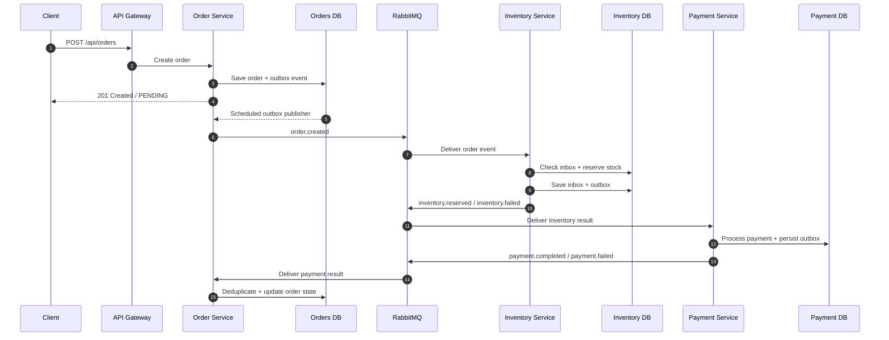

---

## 🧩 Services

| Service | Responsibility | Database |
|---|---|---|
| **API Gateway** | Single external entry point; routes client requests to backend services | — |
| **Order Service** | Order creation, request idempotency, order state transitions, outbox publishing, payment-result consumption | `orders` |
| **Inventory Service** | Stock reservation, inventory concurrency control, inbox deduplication, reservation-result publishing | `inventory_db` |
| **Payment Service** | Payment processing after inventory reservation, payment state management, inbox/outbox event handling | `payment_db` |
| **Notification Service** | Consumes payment events and creates notification records | `notification_db` |

### Order states

The workflow uses explicit state transitions. The initial order state is `PENDING`; successful payment completion transitions it to `CONFIRMED`. Inventory or payment failure paths are represented separately.

```text
PENDING
  ├── Inventory failure ──> INVENTORY_FAILED
  ├── Payment failure   ──> PAYMENT_FAILED
  └── Payment completed ──> CONFIRMED
```

---

## 🔄 Order processing workflow

1. The client submits an order through `POST /api/orders`.
2. The Order Service stores the order and its `order.created` outbox event in a local database transaction.
3. The scheduled outbox publisher sends the event to RabbitMQ.
4. The Inventory Service checks its inbox to detect previously processed event IDs.
5. For a new event, the Inventory Service reserves stock using a transaction and writes the corresponding inbox and outbox records.
6. The Payment Service consumes the inventory result and processes the payment.
7. The Order Service consumes `payment.completed` or `payment.failed`, checks its inbox, and updates the order state.
8. The Notification Service consumes payment events and creates notification records.

### RabbitMQ message flow

| Producer | Exchange / routing key | Consumer queue | Purpose |
|---|---|---|---|
| Order Service | `order.events` / `order.created` | `inventory.orders` | New order notification to Inventory |
| Inventory Service | Inventory result event | `payment.inventory.results` | Reservation result for Payment |
| Payment Service | `payment.events` / `payment.completed` | `order.payment.results` | Successful payment result for Order |
| Payment Service | `payment.events` / `payment.failed` | `order.payment.results` | Failed payment result for Order |
| Payment Service | Payment event routing | `notification.payment.events` | Payment event for Notification |

The queue names and routing keys above describe the configured workflow. Check the service `RabbitMQConfig` classes for the authoritative exchange and binding definitions.

---

## 🛡️ Reliability patterns

### Transactional Outbox

Business data and the corresponding outbox record are persisted in the same local database transaction. A scheduled publisher subsequently sends pending events to RabbitMQ.

This avoids relying on a database update and broker publish being one distributed transaction.

### Inbox-based idempotency

Consumers persist processed event IDs in an inbox table in the same transaction as their business update. When the same event is delivered again, the consumer can detect it and skip the repeated business operation.

Verified duplicate replay: the same `PAYMENT_COMPLETED` event (`eventId=195`) was published again to `payment.events`. RabbitMQ routed it, the Order Service queue had an active consumer and no pending/unacknowledged messages, and the database retained one inbox record with the order still `CONFIRMED` at version `1`.

### Optimistic locking

JPA `@Version` fields are used to detect conflicting concurrent updates. Inventory reservation updates the inventory version as stock is reserved.

### Retry and backoff

Outbox publishers track attempts and retry scheduling metadata such as `next_attempt_at` and `last_error`. Retry delays use backoff rather than continuously retrying failed publishes.

> **Delivery semantics:** Outbox publishing and consumer idempotency are designed to tolerate message redelivery. This README does not claim exactly-once delivery. End-to-end delivery guarantees depend on broker durability, message persistence, publisher confirms, and consumer acknowledgement configuration.

### Correlation and causation

Events carry identifiers used to trace a business workflow:

- `eventId` — identifies an individual event.
- `correlationId` — links events belonging to the same workflow.
- `causationId` — identifies the event that caused the current event.

---

## 📈 Load testing results

The order-creation endpoint was tested with **k6** using three separate runs. Each run used a different number of virtual users and iteration count.

### Test summary

| Test run | Concurrent VUs | Orders submitted | HTTP success | Eventual order/payment completion | HTTP throughput |
|---|---:|---:|---:|---:|---:|
| Run 1 | 5 | 100 | 100% | 100% | 16.75 req/s |
| Run 2 | 10 | 50 | 100% | 100% | 21.86 req/s |
| Run 3 | 20 | 40 | 100% | 100% | 41.73 req/s |
| **Total** | **5–20** | **190** | **100%** | **100%** | — |

### Observed HTTP request latency

| Test run | Average | Median | p95 |
|---|---:|---:|---:|
| 5 VUs / 100 orders | 93.07 ms | 46.04 ms | 215.16 ms |
| 10 VUs / 50 orders | 249.19 ms | 58.02 ms | 1,030 ms |
| 20 VUs / 40 orders | 255.73 ms | 256.02 ms | 468.70 ms |

**Important measurement note:** These latency values are k6 HTTP request durations for order creation. They are not end-to-end asynchronous event-processing latency. The test runs also used different iteration counts, so the results should be treated as observations from separate test runs—not as a controlled benchmark proving that latency improves with concurrency.

### End-to-end verification

After each run, database state was checked to confirm that submitted orders progressed beyond the initial `PENDING` state and that the corresponding payments succeeded. Across the three runs:

- **190** orders submitted.
- **190** orders eventually confirmed.
- **190** successful payment records.
- **100%** HTTP request success in the recorded runs.
- **100%** eventual order/payment completion in the recorded runs.

---

## 🧪 Failure and duplicate-event testing

### 1. RabbitMQ outage and recovery

A broker outage was simulated by stopping RabbitMQ, then creating an order while the broker was unavailable.

After RabbitMQ was restarted, the workflow recovered: the test order eventually reached `CONFIRMED`, its payment reached `SUCCEEDED`, and inventory reservation was reflected in the inventory database.

This validates recovery of the tested business workflow after broker unavailability. It is not a claim that every failure mode or every service restart scenario has been exhaustively tested.

### 2. Duplicate payment-event replay

The original `PAYMENT_COMPLETED` message for order `195` was republished with the same event ID and payload.

Observed results:

| Verification | Result |
|---|---:|
| RabbitMQ publish result | Published and routed |
| Order payment queue consumers | 1 |
| Messages ready | 0 |
| Messages unacknowledged | 0 |
| Inbox records for event `195` | 1 |
| Order state | `CONFIRMED` |
| Order version | `1` |
| Payment state | `SUCCEEDED` |

The replay was consumed without a second inbox record or another order-state transition.

### 3. Inventory consistency

Inventory quantity and version fields were inspected after load and recovery tests. For the 20-VU run, product `3` showed `7` available units, `193` reserved units, and version `193`, consistent with the 193 successful reservations recorded at that checkpoint.

---

## 🖼️ Testing screenshots

The screenshots below are included in [`docs/testing/`](docs/testing/). They provide supporting evidence for the k6 runs, database verification, RabbitMQ queue state, and duplicate-event replay.

### k6 load-test runs

**10-VU run output**

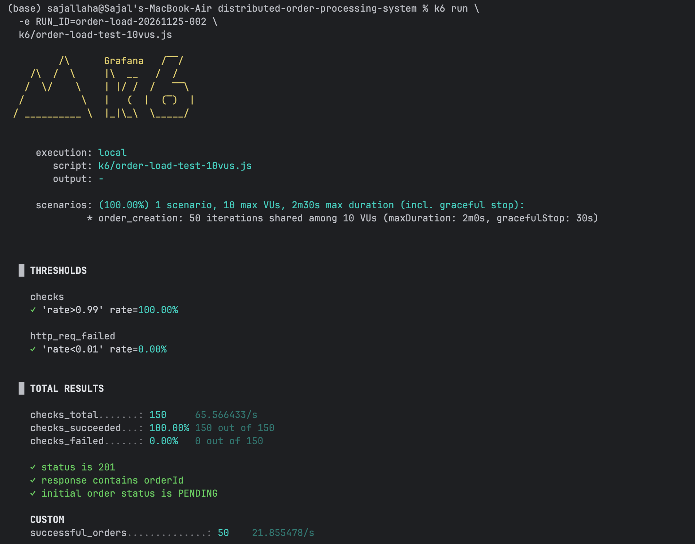

**10-VU latency and throughput metrics**

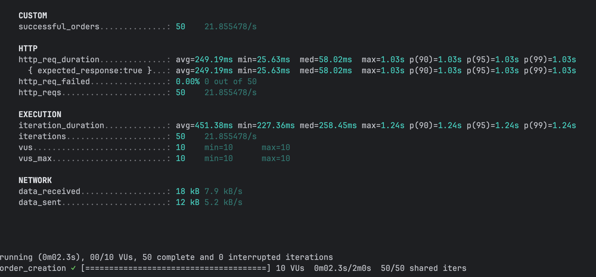

**Comparison of all three load-test runs**

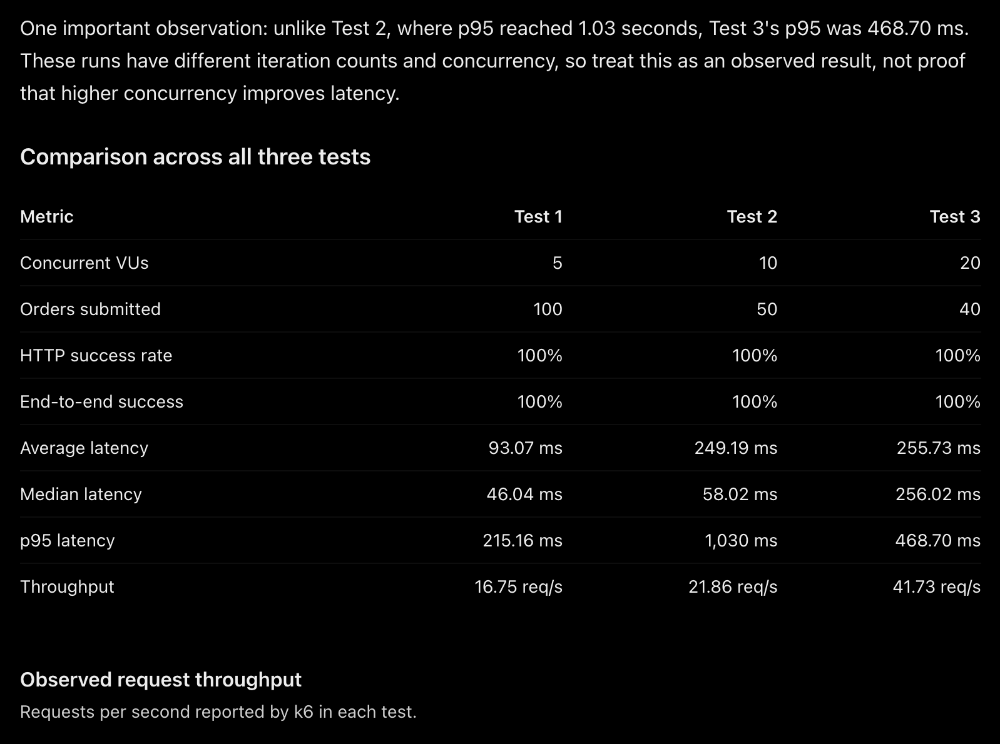

**Observed HTTP throughput**

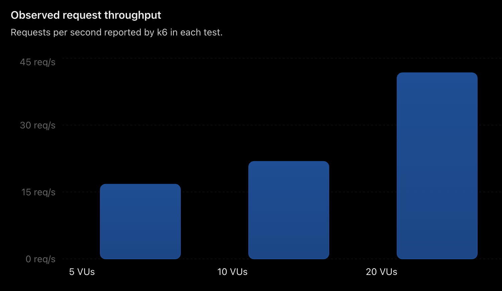

### Database and workflow verification

**Inventory, outbox, and inbox records**

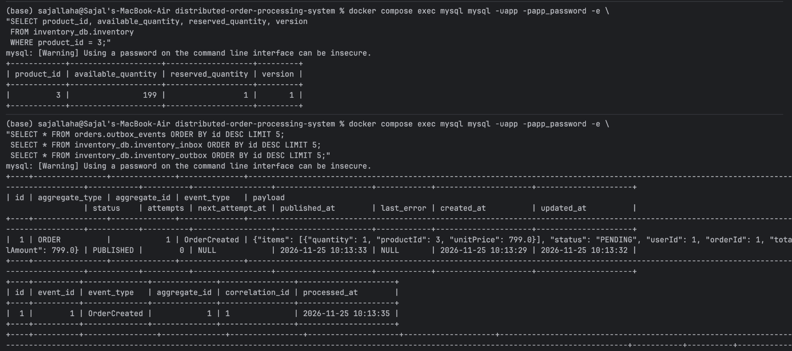

**Order, payment, and inventory state after load testing**

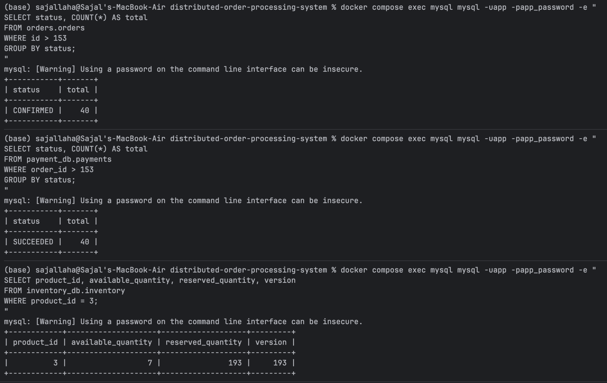

**100-order end-to-end verification**

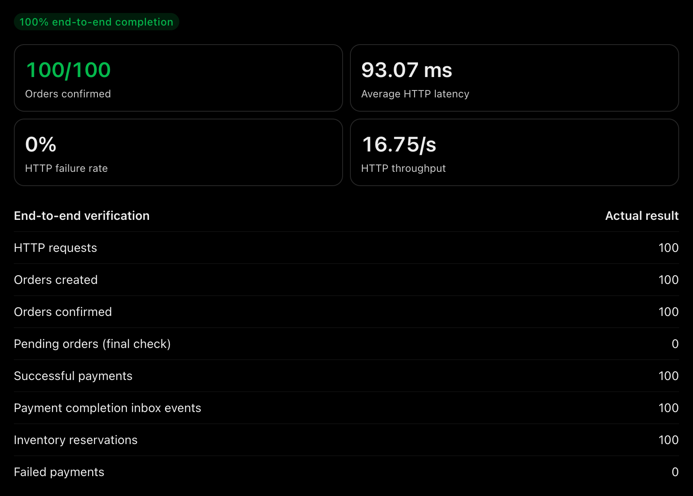

### RabbitMQ and duplicate-event verification

**RabbitMQ Management UI queue state**

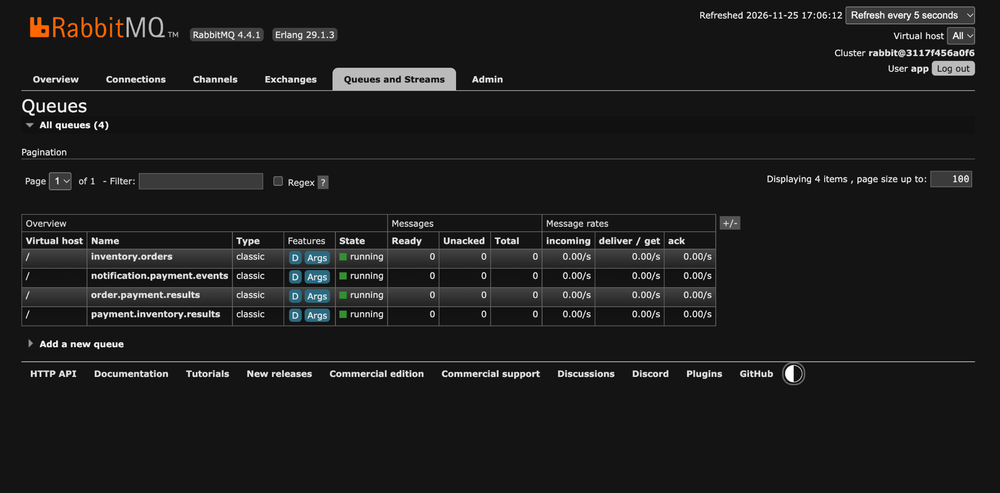

**Duplicate-event replay and idempotency verification**

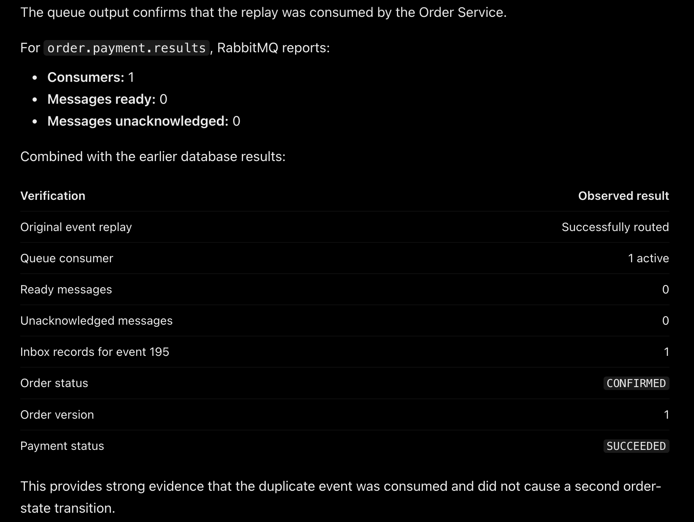

**Service logs during workflow processing**

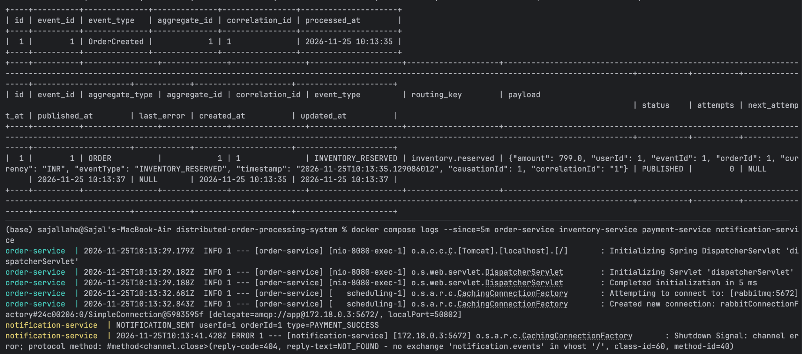

---

## 🧰 Technology stack

| Area | Technologies |
|---|---|
| Language | Java 21 |
| Framework | Spring Boot 3.5.x, Spring Data JPA, Hibernate, Spring AMQP |
| API routing | Spring Cloud Gateway / API Gateway |
| Messaging | RabbitMQ 4 |
| Databases | MySQL 8.4 |
| Database migrations | Flyway |
| Concurrency | JPA optimistic locking (`@Version`) |
| Reliability | Transactional Outbox, Inbox idempotency, retry/backoff |
| Testing | k6, SQL verification, RabbitMQ Management UI |
| Containers | Docker, Docker Compose |
| Build | Maven |

---

## 🚀 Run locally

### Prerequisites

- Java 21
- Docker Desktop / Docker Engine with Docker Compose
- Maven (if building outside Docker)
- k6 (only if running load tests)

### Start the application

```bash
# Clone the repository
git clone https://github.com/sajal327/distributed-order-processing-system
cd distributed-order-processing-system

# Configure local environment variables in .env

# Build and start the services
docker compose up -d --build

# Check container status
docker compose ps

# Follow service logs
docker compose logs -f order-service
docker compose logs -f inventory-service
docker compose logs -f payment-service
docker compose logs -f notification-service
docker compose logs -f api-gateway

# Follow all application logs
docker compose logs -f
```

### Local service endpoints

| Component | Address |
|---|---|
| API Gateway | `http://localhost:8080` |
| RabbitMQ Management UI | `http://localhost:15672` |
| RabbitMQ AMQP | `localhost:5672` |
| MySQL | `localhost:3306` |

### Stop the application

```bash
docker compose down
```

This stops and removes the containers and network while preserving named volumes. Do not add `-v` unless you intentionally want to delete persisted local database and broker data.

---

## Check MySQL databases and tables
Open a MySQL shell inside the container:
```bash
docker compose exec mysql mysql -uapp -papp_password
```
List databases:
```bash
SHOW DATABASES;
```

List tables in each database:
```bash
USE orders;
SHOW TABLES;

USE inventory_db;
SHOW TABLES;

USE payment_db;
SHOW TABLES;

USE notification_db;
SHOW TABLES;
```

Exit:
```bash
EXIT;
```

## 📬 Create a new Order 
First, check product 3's available stock:
```bash
docker compose exec mysql mysql -uapp -papp_password -e "
SELECT product_id, available_quantity, reserved_quantity, version
FROM inventory_db.inventory
WHERE product_id = 3;
"
```

The following example creates an order through the API Gateway. Use a valid user and product ID from your local seed data.

```bash
curl --request POST 'http://localhost:8080/api/orders' \
  --header 'Content-Type: application/json' \
  --header 'Idempotency-Key: demo-order-001' \
  --data '{
    "userId": 1,
    "items": [
      {
        "productId": 3,
        "quantity": 1
      }
    ]
  }'
```

Expected initial response: HTTP 201 Created, with an order ID and initial status PENDING.

Save the returned orderId. For the examples below, I'll use:
```
ORDER_ID=196
```
---
### Verify the Order Service database
Check the order

```bash
docker compose exec mysql mysql -uapp -papp_password -e "
SELECT id, user_id, status, version, created_at
FROM orders.orders
WHERE id = 196;
"
```

Check order items
```bash
docker compose exec mysql mysql -uapp -papp_password -e "
SELECT *
FROM orders.order_items
WHERE order_id = 196;
"
```

Check the Order Outbox
```bash
docker compose exec mysql mysql -uapp -papp_password -e "
SELECT
id,
aggregate_id,
event_type,
status,
attempts,
next_attempt_at,
published_at,
last_error
FROM orders.outbox_events
WHERE aggregate_id = 196
ORDER BY id;
"
```

Check the Order Inbox
```bash
docker compose exec mysql mysql -uapp -papp_password -e "
SELECT *
FROM orders.order_inbox
WHERE aggregate_id = 196
ORDER BY id;
"
```
---

### Verify RabbitMQ exchanges, queues and consumers
List exchanges
```bash
docker compose exec rabbitmq rabbitmqctl list_exchanges name type durable
```

List queues
```bash
docker compose exec rabbitmq rabbitmqctl list_queues \
name messages_ready messages_unacknowledged consumers
```

Check queue bindings
```bash
docker compose exec rabbitmq rabbitmqctl list_bindings \
source_name destination_name destination_kind routing_key
```

Check RabbitMQ connections
```bash
docker compose exec rabbitmq rabbitmqctl list_connections \
user peer_host peer_port state
```

Check consumers
```bash
docker compose exec rabbitmq rabbitmqctl list_consumers
```

Monitor queues continuously
```bash
watch -n 2 'docker compose exec -T rabbitmq rabbitmqctl list_queues name messages_ready messages_unacknowledged consumers'
```

Press Ctrl+C to stop monitoring.

### Verify Inventory Service

Check available and reserved inventory
```bash
docker compose exec mysql mysql -uapp -papp_password -e "
SELECT
product_id,
available_quantity,
reserved_quantity,
version
FROM inventory_db.inventory
WHERE product_id = 3;
"
```

### Verify Payment Service

Check payment status
```bash
docker compose exec mysql mysql -uapp -papp_password -e "
SELECT order_id, status
FROM payment_db.payments
WHERE order_id = 196;
"
```

### Verify Notification Service

Check its available tables:
```bash
docker compose exec mysql mysql -uapp -papp_password -e "
SHOW TABLES FROM notification_db;
"
```

Inspect the notification table structure:
```bash
docker compose exec mysql mysql -uapp -papp_password -e "
DESCRIBE notification_db.notifications;
"
```

Then inspect the latest notification records:
```bash
docker compose exec mysql mysql -uapp -papp_password -e "
SELECT *
FROM notification_db.notifications
ORDER BY id DESC
LIMIT 10;
"
```


## 📁 Project structure

The repository is organized as a Maven multi-module project. Each backend service has its own `src/main` source tree, application configuration, Flyway migrations (where applicable), Dockerfile, and Maven module definition. The `k6/` directory contains the load and failure-test scripts.

```text
distributed-order-processing-system/
├── .github/
├── api-gateway/
│   ├── src/
│   │   └── main/
│   │       ├── java/
│   │       │   └── com/example/api/gateway/
│   │       │       └── Application.java
│   │       └── resources/
│   │           └── application.yml
│   ├── Dockerfile
│   └── pom.xml
├── docs/
│   ├── System-Architecture.png
│   ├── architecture_flow.png
│   ├── payment_flow.png
│   └── testing/
│       ├── k6-10-vus-output.png
│       ├── k6-10-vus-metrics.png
│       ├── load-test-comparison.png
│       ├── load-test-throughput.png
│       ├── database-outbox-inbox.png
│       ├── database-load-test-state.png
│       ├── end-to-end-100-orders.png
│       ├── rabbitmq-queues.png
│       ├── duplicate-event-verification.png
│       └── service-logs.png
├── inventory-service/
│   ├── src/
│   │   └── main/
│   │       ├── java/
│   │       │   └── com/example/inventory/service/
│   │       │       ├── config/
│   │       │       ├── entity/
│   │       │       ├── messaging/
│   │       │       ├── repository/
│   │       │       ├── service/
│   │       │       └── Application.java
│   │       └── resources/
│   │           ├── db/migration/
│   │           └── application.yml
│   ├── Dockerfile
│   └── pom.xml
├── k6/
│   ├── order-load-test.js
│   ├── order-load-test-10vus.js
│   ├── order-load-test-20vus.js
│   └── order-rabbitmq-outage.js
├── notification-service/
│   ├── src/
│   │   └── main/
│   │       ├── java/
│   │       │   └── com/example/notification/service/
│   │       │       ├── config/
│   │       │       ├── controller/
│   │       │       ├── domain/
│   │       │       ├── listener/
│   │       │       ├── messaging/
│   │       │       ├── repository/
│   │       │       ├── service/
│   │       │       └── Application.java
│   │       └── resources/
│   │           ├── db/migration/
│   │           └── application.yml
│   ├── Dockerfile
│   └── pom.xml
├── order-service/
│   ├── src/
│   │   └── main/
│   │       ├── java/
│   │       │   └── com/example/order/service/
│   │       │       ├── config/
│   │       │       ├── controller/
│   │       │       ├── dto/
│   │       │       ├── entity/
│   │       │       ├── messaging/
│   │       │       ├── repository/
│   │       │       ├── service/
│   │       │       └── Application.java
│   │       └── resources/
│   │           ├── db/migration/
│   │           └── application.yml
│   ├── Dockerfile
│   └── pom.xml
├── payment-service/
│   ├── src/
│   │   └── main/
│   │       ├── java/
│   │       │   └── com/example/payment/service/
│   │       │       ├── config/
│   │       │       ├── domain/
│   │       │       ├── listener/
│   │       │       ├── messaging/
│   │       │       ├── repository/
│   │       │       ├── service/
│   │       │       └── Application.java
│   │       └── resources/
│   │           ├── db/migration/
│   │           └── application.yml
│   ├── Dockerfile
│   └── pom.xml
├── .env
├── .gitignore
├── docker-compose.yml
├── pom.xml
└── README.md
```

### Module responsibilities

| Directory | Purpose |
|---|---|
| `.github/` | Repository-level GitHub configuration and workflows |
| `api-gateway/` | External API entry point and request routing |
| `order-service/` | Order creation, order state management, and order event handling |
| `inventory-service/` | Inventory reservation, concurrency control, and inventory events |
| `payment-service/` | Payment processing and payment event handling |
| `notification-service/` | Notification persistence and payment-event consumption |
| `k6/` | k6 scripts for load testing and RabbitMQ outage testing |
| `docs/` | Architecture diagrams and testing evidence |
| Root `pom.xml` | Parent Maven project and shared module/dependency configuration |
| `docker-compose.yml` | Local multi-container environment |
| `.env` | Local environment configuration |

> **Repository hygiene:** `.env` is shown because it exists in the local project structure. Keep it in `.gitignore` and never commit real credentials. Generated `target/` directories and IDE-specific `.idea/` files are intentionally omitted from this source-oriented tree.

---

## 🎯 Current scope and next steps

### Verified in the current test cycle

- [x] Order creation through the API Gateway
- [x] Asynchronous Order → Inventory → Payment workflow
- [x] Inventory reservation and optimistic-locking version updates
- [x] Transactional outbox publishing and inbox-based deduplication paths
- [x] k6 load testing across 5, 10, and 20 VUs
- [x] End-to-end order and payment state verification for 190 test orders
- [x] Tested recovery after RabbitMQ became unavailable
- [x] Replayed a duplicate payment event and verified unchanged order state

### Further validation / enhancements

- [ ] Add dedicated consumer retry and dead-letter queue (DLQ) tests.
- [ ] Verify publisher confirms and persistent-message configuration before making stronger delivery-guarantee claims.
- [ ] Add controlled end-to-end event latency instrumentation.
- [ ] Complete and test downstream notification-event publishing.
- [ ] Add automated integration tests for service restart and database failure scenarios.
- [ ] Add centralized metrics, tracing, and dashboards.

---

<p align="center">
  <strong>Built to explore reliable asynchronous communication and practical distributed-systems engineering.</strong>
</p>
