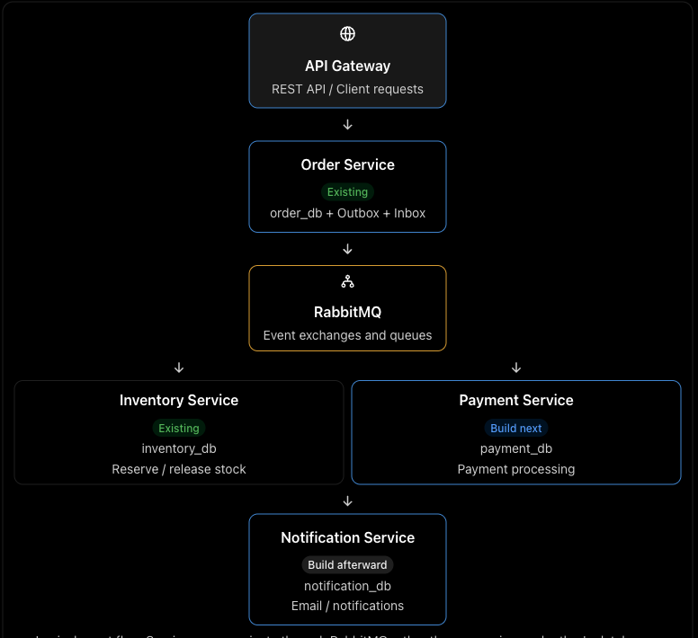
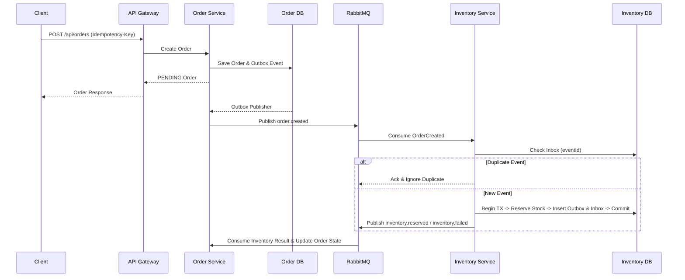
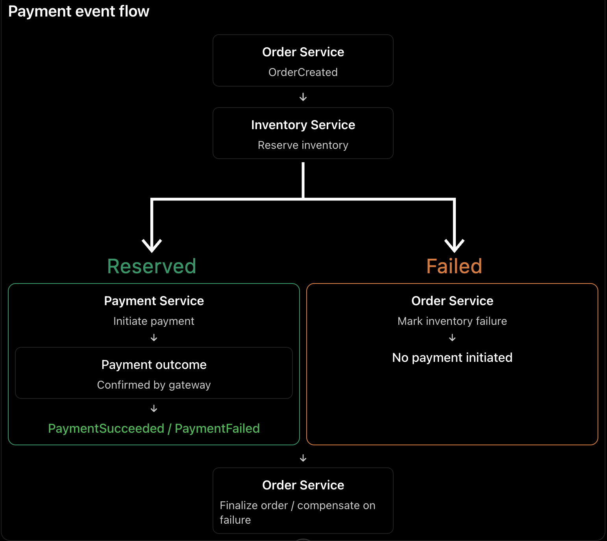
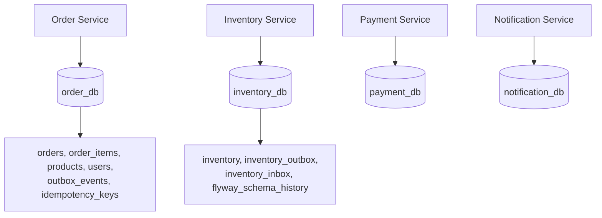

# Distributed Order Processing System

**A production-oriented, event-driven order processing platform built with Java 21, Spring Boot 3.5.x, MySQL 8.4, RabbitMQ 4, Flyway, Docker Compose, and an API Gateway.**

This project demonstrates how to engineer fault-tolerant distributed workflows using **asynchronous event messaging, the Transactional Outbox pattern, Inbox/idempotent consumers, JPA optimistic locking (`@Version`), retry with backoff, correlation/causation tracking, and database-per-service isolation**.

> **Implementation Status:** The **Order $\rightarrow$ Inventory** saga flow is implemented and verified end-to-end. **Payment** and **Notification** services are scaffolded for upcoming stages.

---

## Architecture Overview

Clients communicate through a single **API Gateway** entry point while backend services coordinate asynchronously over **RabbitMQ** exchanges and queues, each owning its isolated database schema.


---

## Core Order $\rightarrow$ Inventory Flow





---

## Services & State Ownership

### 1. API Gateway (`api-gateway`)
* Serves as the external entry point for client requests.
* Routes traffic to downstream microservices while keeping internal service endpoints isolated.

### 2. Order Service
* Owns order creation, validation, idempotency keys (`Idempotency-Key` header), and order state transitions.
* Persists orders and outbox records atomically, publishes `order.created` events, and consumes inventory results.

```text
PENDING
   ├── inventory.reserved ──▶ RESERVED
   └── inventory.failed   ──▶ INVENTORY_FAILED
```

### 3. Inventory Service
* Owns inventory state (`available_quantity`, `reserved_quantity`, `version`) in an isolated database.
* Enforces **optimistic locking** via `@Version`, prevents duplicate event processing via `inventory_inbox`, and publishes `inventory.reserved` or `inventory.failed` via `inventory_outbox`.

```text
On reservation:
  available_quantity -= requested_quantity
  reserved_quantity  += requested_quantity
```

### 4. Payment Service
* Owns payment `processing`, `payment records`, and `payment state transitions` in an isolated database.
* Consumes `inventory.reserved` and `inventory.failed events` from RabbitMQ.
* Processes payments after successful inventory reservation and `publishes payment.completed` or `payment.failed` events.
* Uses `payment_inbox` for `idempotent event processing` and `payment_outbox` for reliable event publishing through the transactional outbox pattern.

```text
PENDING
   ├── Payment successful   ──▶ COMPLETED
   └── Payment unsuccessful ──▶ FAILED
```   


### 5. Notification Service
* Owns user notification records and notification delivery workflows in an isolated database.
* Consumes payment events such as payment.completed and payment.failed from RabbitMQ.
* Persists user notifications in the notifications table and prevents duplicate event processing using notification_inbox.
* Uses notification_outbox to reliably publish notification events through the transactional outbox pattern.
* Exposes GET /api/notifications to retrieve paginated user notifications.
* Supports email notifications through SMTP/Gmail and push notifications through Firebase Cloud Messaging (FCM).

```text
payment.completed
       │
       ▼
Notification Service
       │
       ├── Store notification ──▶ notifications
       ├── Email notification ──▶ SMTP / Gmail
       └── Push notification  ──▶ Firebase Cloud Messaging
``` 

---

## Event-Driven Messaging (RabbitMQ)

| Component | Name / Binding | Purpose |
| :--- | :--- | :--- |
| **Order Exchange** | `order.events` (`order.created`) | Publishes newly created order events |
| **Inventory Exchange** | `inventory.events` (`inventory.reserved`, `inventory.failed`) | Publishes reservation outcomes |
| **Inventory Queue** | `inventory.orders` $\leftarrow$ `order.events` (`order.created`) | Buffers incoming order events for Inventory Service |

---

## Reliability & Distributed Systems Patterns

### Transactional Outbox & Atomic Inventory Transactions
Updating business state and publishing to RabbitMQ are not performed as a single distributed commit. Instead, business mutations and outbox inserts commit in the same local database transaction, and an asynchronous publisher pushes `PENDING` events to RabbitMQ.

* **Successful Reservation:** `Inventory UPDATE` + `Inventory Outbox INSERT` + `Inbox INSERT` in one transaction.
* **Insufficient Stock:** Reservation transaction rolls back so stock is untouched, followed by a new transaction recording `INVENTORY_FAILED` in the outbox and recording the event in the inbox.

### Outbox Publisher, Retries & Inbox Idempotency
* **Publisher Defaults:** Batch size `20`, max attempts `5`, polling interval `3s`, providing **at-least-once delivery**.
* **Retry Tracking:** Tracks `attempts`, `next_attempt_at`, `last_error`, `status` (`PENDING`, `PUBLISHED`, `FAILED`), and `published_at` with backoff before marking exhausted items as `FAILED`.
* **Inbox Deduplication (`inventory_inbox`):** Records processed event IDs inside the same transaction as business updates so redelivered messages are safely ignored.

### Optimistic Locking & Workflow Tracing
* **Optimistic Locking (`@Version`):** Prevents concurrent updates on the same inventory row from overwriting each other; conflicting transactions retry or fail cleanly.
* **Correlation & Causation IDs:** Events carry `eventId` (individual event), `correlationId` (end-to-end business workflow), and `causationId` (parent event that triggered the current event).

---

## Database-per-Service & Flyway Migrations



* Schema changes are versioned with **Flyway** SQL migrations (e.g., `V1__create_inventory.sql` through `V4__create_inventory_inbox.sql` in `inventory-service`).
* Hibernate runs with `spring.jpa.hibernate.ddl-auto: validate` so Flyway remains the single source of truth for schema evolution.

---

## Local Development with Docker Compose

Services included in the stack: **MySQL 8.4**, **RabbitMQ 4**, **Order Service**, **Inventory Service**, **Payment Service**, **Notification Service**, and **API Gateway**.

```bash
# Start all containers
docker compose up -d --build

# Verify container health/status
docker compose ps

# Stream Inventory Service logs
docker compose logs -f inventory-service
```

* **RabbitMQ Management UI:** `http://localhost:15672` (AMQP port `5672`, UI port `15672`)
* **MySQL:** Port `3306`

> **Security Note:** Never commit production secrets or real credentials to Git. Configure database and broker credentials via environment variables or a secrets manager.

---

## Technology Stack

| Category | Technologies |
| :--- | :--- |
| **Language & Framework** | Java 21, Spring Boot 3.5.x, Spring Data JPA, Hibernate, Spring AMQP |
| **Messaging & Data** | RabbitMQ 4, MySQL 8.4, Flyway |
| **Packaging & Build** | Docker, Docker Compose, Maven, API Gateway |

---

## Failure Scenarios Handled

1. **DB Commit Succeeds, RabbitMQ Publish Fails:** Outbox row stays `PENDING`; publisher retries on subsequent cycles.
2. **RabbitMQ Publish Succeeds, DB Status Update Fails:** Event may be republished; consumer checks `inventory_inbox` and skips duplicate work.
3. **Duplicate Event Delivery:** Second delivery of the same `eventId` is detected in `inventory_inbox` and ignored.
4. **Insufficient Stock:** Stock update rolls back; `inventory.failed` event is emitted via outbox.

---

## Testing the Order $\rightarrow$ Inventory Flow

### 1. Successful Reservation
```bash
curl -X POST http://localhost:8080/api/orders \
  -H "Content-Type: application/json" \
  -H "Idempotency-Key: inventory-test-success-001" \
  -d '{
    "userId": 2,
    "items": [
      {
        "productId": 4,
        "quantity": 5
      }
    ]
  }'
```
Expected result: `available_quantity` decreases, `reserved_quantity` increases, `version` increments, and `INVENTORY_RESERVED` is published to `inventory.events`.

### 2. Insufficient Inventory
```bash
curl -X POST http://localhost:8080/api/orders \
  -H "Content-Type: application/json" \
  -H "Idempotency-Key: inventory-test-failure-001" \
  -d '{
    "userId": 2,
    "items": [
      {
        "productId": 5,
        "quantity": 100
      }
    ]
  }'
```
Expected result: Inventory quantities remain unchanged, and `INVENTORY_FAILED` is published to `inventory.events`.

---

## Project Structure

```text
distributed-order-processing-system/
├── README.md
├── docker-compose.yml
├── pom.xml
├── api-gateway/
│   ├── Dockerfile
│   ├── pom.xml
│   └── src/main/
│       ├── java/com/example/api.gateway/Application.java
│       └── resources/application.yml
├── docs/
│   └── architecture.md
├── inventory-service/
│   ├── Dockerfile
│   ├── pom.xml
│   └── src/main/
│       ├── java/com/example/inventory.service/
│       │   ├── Application.java
│       │   ├── config/RabbitMQConfig.java
│       │   ├── entity/{Inventory,InventoryInboxEvent,InventoryOutboxEvent}.java
│       │   ├── messaging/{InventoryEventListener,InventoryFailedEvent,InventoryOutboxPublisher,InventoryReservationResult,InventoryReservationResultListener,InventoryReservedEvent,OrderCreatedEvent}.java
│       │   ├── repository/{InventoryInboxRepository,InventoryOutboxRepository,InventoryRepository}.java
│       │   └── service/InventoryService.java
│       └── resources/
│           ├── application.yml
│           └── db/migration/V{1..4}__*.sql
├── notification-service/
│   ├── Dockerfile
│   ├── pom.xml
│   └── src/main/
│       ├── java/com/example/notification.service/Application.java
│       └── resources/application.yml
├── order-service/
│   ├── Dockerfile
│   ├── pom.xml
│   └── src/main/
│       ├── java/com/example/order/service/
│       │   ├── Application.java
│       │   ├── config/RabbitMQConfig.java
│       │   ├── controller/OrderController.java
│       │   ├── dto/{CreateOrderRequest,OrderItemRequest,OrderResponse}.java
│       │   ├── entity/{Category,IdempotencyKey,Order,OrderItem,OutboxEvent,Product,User}.java
│       │   ├── messaging/{OrderCreatedEvent,OutboxPublisher}.java
│       │   ├── repository/{CategoryRepository,IdempotencyKeyRepository,OrderItemRepository,OrderRepository,OutboxEventRepository,ProductRepository,UserRepository}.java
│       │   └── service/OrderService.java
│       └── resources/
│           ├── application.yml
│           └── db/migration/V{1..13}__*.sql
└── payment-service/
    ├── Dockerfile
    ├── pom.xml
    └── src/main/
        ├── java/com/example/payment.service/Application.java
        └── resources/application.yml
```

---

## Production-Grade Target Architecture

```text
                ┌──────────────────────┐
                │      API Gateway     │
                └──────────┬───────────┘
                           │
             ┌─────────────┴─────────────┐
             │                           │
        Order Service              Other Services
             │                           │
         order_db                  service_db
             │                           │
          Outbox                         │
             │                           │
             └──────────┬────────────────┘
                        │
                    RabbitMQ
                        │
          ┌─────────────┼─────────────┐
          │             │             │
       Inventory     Payment     Notification
          │             │             │
      inventory_db   payment_db   notification_db
          │
        Inbox
          │
        Outbox
```

Target capabilities: **at-least-once event delivery**, **idempotent consumers**, **atomic local transactions**, **no cross-service database transactions**, **database-per-service ownership**, **retryable asynchronous processing**, **observable event flows**, **failure isolation**, **saga-based workflows**, and **horizontal scalability**.
